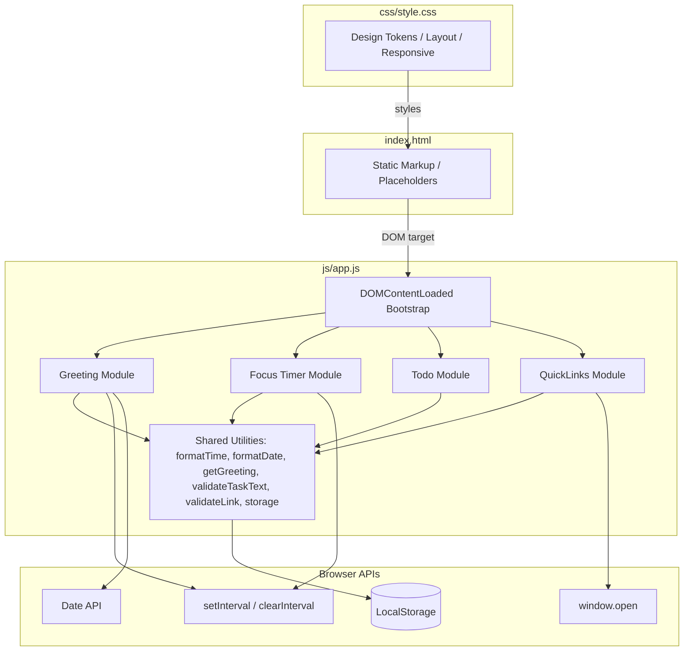

# Design Document

## Overview

The To-Do Life Dashboard is a single-page web application delivered as three static files: `index.html`, `css/style.css`, and `js/app.js`. It runs entirely in the browser with no server, no build step, and no third-party dependencies. Four self-contained modules — Greeting, Focus Timer, To-Do List, and Quick Links — share a single JavaScript module in `app.js` and communicate only through direct function calls and LocalStorage. All state that must survive a page reload is stored in LocalStorage as JSON.

The design prioritises **simplicity and correctness** over architectural sophistication: plain module-scoped variables hold runtime state, a renderer function per module rebuilds the relevant DOM fragment on every mutation, and a single `DOMContentLoaded` listener bootstraps the whole application.

---

## Architecture

The application follows a **unidirectional data flow** pattern within each module:

```
User Event → State Mutation → Persist to LocalStorage → Re-render DOM
```

There is no shared global state across modules. Each module owns its own state object(s) and its own renderer. Cross-module concerns (e.g., shared CSS variables, font stack) are handled entirely in CSS.



### Key Design Decisions

1. **No framework, no bundler.** The entire app is one `app.js` file read top-to-bottom. Module separation is achieved with IIFE-style scoping or clearly separated function namespaces within the file.
2. **Render-on-mutate.** Each module exposes a `render()` function that unconditionally rebuilds its DOM list from the current in-memory state array. This avoids complex diffing and is fast enough for the expected data sizes (dozens of tasks/links).
3. **LocalStorage as the single persistence layer.** All writes happen synchronously after every mutation. Reads happen once at bootstrap. Errors (quota exceeded, corrupt JSON) are caught and surfaced in the UI without crashing.
4. **Shared utility layer.** Pure functions — `getGreeting`, `formatTime`, `formatDate`, `validateTaskText`, `validateLink`, `saveToStorage`, `loadFromStorage` — are defined once and reused across modules, making them independently testable.

---

## Components and Interfaces

### 1. Bootstrap (`init`)

```
init()
  ├── greetingModule.init()
  ├── focusTimerModule.init()
  ├── todoModule.init()
  └── quickLinksModule.init()
```

Each module's `init()` function:
1. Loads persisted data from LocalStorage (if applicable).
2. Attaches DOM event listeners.
3. Calls the module's `render()` to draw the initial UI.

---

### 2. Greeting Module

**Public interface:**

| Function | Signature | Description |
|---|---|---|
| `greetingModule.init()` | `() → void` | Starts the 1-second interval to update time/date/greeting |
| `getGreeting(hour)` | `(number) → string` | Pure: maps hour (0–23) → greeting string |
| `formatDate(date)` | `(Date) → string` | Pure: formats a Date as "Weekday, Month Day, Year" |
| `formatTimeDisplay(date)` | `(Date) → string` | Pure: formats a Date as "HH:MM:SS" (24-hour) |

**Runtime state:** A single `intervalId` reference stored in the module closure.

**DOM targets:** `#greeting-text`, `#current-time`, `#current-date`

**Error handling:** If `new Date()` throws or returns an invalid date, each display element shows a fallback placeholder string (`"--:--:--"`, `"---"`, `"---"`).

---

### 3. Focus Timer Module

**Public interface:**

| Function | Signature | Description |
|---|---|---|
| `focusTimerModule.init()` | `() → void` | Renders initial 25:00 state and attaches button listeners |
| `timerTick(state)` | `(TimerState) → TimerState` | Pure: returns next state after one tick |
| `timerStart(state)` | `(TimerState) → TimerState` | Pure: returns started state (guard: no-op if already running or complete) |
| `timerStop(state)` | `(TimerState) → TimerState` | Pure: returns paused state |
| `timerReset(state)` | `(TimerState) → TimerState` | Pure: returns fresh 1500-second state |
| `formatTime(totalSeconds)` | `(number) → string` | Pure: converts seconds → "MM:SS" |

**TimerState shape:**
```javascript
{
  remaining: number,   // seconds remaining (0–1500)
  running: boolean,    // whether the interval is active
  complete: boolean    // whether the session has ended at 0
}
```

**Runtime state:** One `TimerState` object and one `intervalId` stored in the module closure.

**DOM targets:** `#timer-display`, `#timer-start`, `#timer-stop`, `#timer-reset`, `#timer-message`

---

### 4. To-Do Module

**Public interface:**

| Function | Signature | Description |
|---|---|---|
| `todoModule.init()` | `() → void` | Loads tasks, renders list, attaches form listener |
| `validateTaskText(text)` | `(string) → ValidationResult` | Pure: validates trimmed text is 1–200 chars |
| `addTask(tasks, text)` | `(Task[], string) → Task[] \| null` | Pure: returns new tasks array or null if invalid |
| `deleteTask(tasks, id)` | `(Task[], string) → Task[]` | Pure: returns filtered tasks array |
| `toggleTask(tasks, id)` | `(Task[], string) → Task[]` | Pure: flips completed flag on matching task |
| `editTask(tasks, id, text)` | `(Task[], string, string) → Task[] \| null` | Pure: returns updated array or null if invalid text |
| `todoModule.render(tasks)` | `(Task[]) → void` | Rebuilds the task list DOM |

**Task shape:**
```javascript
{
  id: string,          // crypto.randomUUID() or Date.now().toString()
  text: string,        // trimmed description (1–200 chars)
  completed: boolean   // completion state
}
```

**ValidationResult shape:**
```javascript
{
  valid: boolean,
  reason: string | null  // null when valid
}
```

**LocalStorage key:** `"todo-tasks"` — stored as JSON array of Task objects.

**DOM targets:** `#todo-input`, `#todo-add-btn`, `#todo-list`

---

### 5. Quick Links Module

**Public interface:**

| Function | Signature | Description |
|---|---|---|
| `quickLinksModule.init()` | `() → void` | Loads links, renders buttons, attaches form listener |
| `validateLink(label, url)` | `(string, string) → ValidationResult` | Pure: validates label ≤50 chars (non-empty) and URL starts with http(s):// + ≥1 char |
| `isDuplicate(links, label, url)` | `(Link[], string, string) → boolean` | Pure: checks for identical label+URL pair |
| `addLink(links, label, url)` | `(Link[], string, string) → Link[] \| null` | Pure: returns new links array or null if invalid/duplicate |
| `deleteLink(links, id)` | `(Link[], string) → Link[]` | Pure: returns filtered links array |
| `quickLinksModule.render(links)` | `(Link[]) → void` | Rebuilds the link buttons DOM |

**Link shape:**
```javascript
{
  id: string,    // crypto.randomUUID() or Date.now().toString()
  label: string, // display text (1–50 chars)
  url: string    // validated URL string
}
```

**LocalStorage key:** `"quick-links"` — stored as JSON array of Link objects.

**DOM targets:** `#ql-label-input`, `#ql-url-input`, `#ql-add-btn`, `#ql-error`, `#ql-list`

---

### 6. Shared Storage Utilities

```javascript
saveToStorage(key, data)   // JSON.stringify + localStorage.setItem; throws on quota error
loadFromStorage(key)       // localStorage.getItem + JSON.parse; returns null on parse error
```

Storage errors are caught at the call site in each module, which then decides whether to show an error message and roll back the in-memory state.

---

## Data Models

### LocalStorage Schema

| Key | Type | Description |
|---|---|---|
| `"todo-tasks"` | `Task[]` (JSON) | All user tasks, in insertion order |
| `"quick-links"` | `Link[]` (JSON) | All saved link bookmarks, in insertion order |

Focus Timer state is **not** persisted — it always resets to 25:00 on page load (per Requirement 2.1).

### Greeting Module — no persistent state (reads `Date` on every tick).

### Validation Rules (codified)

| Field | Rule |
|---|---|
| Task text | `text.trim().length >= 1 && text.trim().length <= 200` |
| Link label | `label.trim().length >= 1 && label.trim().length <= 50` |
| Link URL | `/^https?:\/\/.+/.test(url.trim())` |
| Duplicate link | `links.some(l => l.label === label.trim() && l.url === url.trim())` |

---

## Correctness Properties

*A property is a characteristic or behavior that should hold true across all valid executions of a system — essentially, a formal statement about what the system should do. Properties serve as the bridge between human-readable specifications and machine-verifiable correctness guarantees.*

### Property 1: Greeting mapping covers all 24 hours exactly

*For any* integer hour in [0, 23], `getGreeting(hour)` shall return exactly one of {"Good Morning", "Good Afternoon", "Good Evening", "Good Night"}, with no hour mapping to two different greetings and no hour returning an unexpected value. Specifically: hours [5–11] → "Good Morning", [12–17] → "Good Afternoon", [18–20] → "Good Evening", [0–4] and [21–23] → "Good Night".

**Validates: Requirements 1.3, 1.4, 1.5, 1.6**

---

### Property 2: Date format always matches the expected pattern

*For any* valid `Date` object, `formatDate(date)` shall return a string that, when split on `", "` and `" "`, yields a valid weekday name, a valid month name, a day number (1–31), and a four-digit year — all matching the Date's actual local weekday, month, day, and year values.

**Validates: Requirements 1.2**

---

### Property 3: Timer `formatTime` always produces valid MM:SS

*For any* integer `s` in [0, 1500], `formatTime(s)` shall return a string of the form `"MM:SS"` where `MM` is a zero-padded two-digit minute count and `SS` is a zero-padded two-digit second count, and `parseInt(MM) * 60 + parseInt(SS) === s`.

**Validates: Requirements 2.6**

---

### Property 4: Timer reset is always idempotent from any state

*For any* `TimerState` (including running, paused, or complete), `timerReset(state)` shall always return a state with `remaining === 1500`, `running === false`, and `complete === false`.

**Validates: Requirements 2.1, 2.4**

---

### Property 5: Timer start is a no-op when already running or complete

*For any* `TimerState` where `running === true` or `complete === true`, `timerStart(state)` shall return a state identical to the input — `remaining`, `running`, and `complete` are all unchanged.

**Validates: Requirements 2.7, 2.8**

---

### Property 6: Valid task description always grows the task list by exactly one

*For any* task list and any string whose trimmed length is in [1, 200], `addTask(tasks, text)` shall return a new array whose length is exactly `tasks.length + 1`, and whose last element has a `text` property equal to the trimmed input and `completed === false`.

**Validates: Requirements 3.2**

---

### Property 7: Invalid task description never mutates the task list

*For any* task list and any string whose trimmed length is 0 (empty or whitespace-only) or greater than 200, `addTask(tasks, text)` shall return `null` (rejection), leaving the original tasks array unchanged.

**Validates: Requirements 3.3**

---

### Property 8: Completion toggle is a round-trip

*For any* task list and any valid task ID in that list, applying `toggleTask` twice in succession shall return a task array where the targeted task's `completed` value is identical to its original value (double-toggle is identity).

**Validates: Requirements 3.4, 3.5**

---

### Property 9: Delete reduces list length by exactly one and excludes the deleted task

*For any* non-empty task list and any valid task ID in that list, `deleteTask(tasks, id)` shall return an array of length `tasks.length - 1` that contains no task with the deleted `id`.

**Validates: Requirements 3.6**

---

### Property 10: Task description validation is symmetric for add and edit

*For any* task list, any valid task ID, and any string, `editTask(tasks, id, text)` shall accept (return updated array) if and only if `validateTaskText(text).valid === true`, and reject (return `null`) if and only if `validateTaskText(text).valid === false`.

**Validates: Requirements 3.8, 3.9**

---

### Property 11: Task list serialization round-trip preserves all data

*For any* array of Task objects, `JSON.parse(JSON.stringify(tasks))` shall produce an array of equal length where each element has the same `id`, `text`, and `completed` values as the original — i.e., serialization to and from JSON is lossless for the Task schema.

**Validates: Requirements 3.11**

---

### Property 12: Valid label+URL always grows the links list by exactly one

*For any* links list, a non-empty label of at most 50 chars, and a URL matching `^https?:\/\/.+`, `addLink(links, label, url)` shall return a new array of length `links.length + 1` containing a Link with the provided label and URL — provided the label+URL pair is not already in the list.

**Validates: Requirements 4.2**

---

### Property 13: Invalid or duplicate label+URL never mutates the links list

*For any* links list and any label+URL combination that is either malformed (missing label, invalid URL format) or already present in the list, `addLink(links, label, url)` shall return `null`, leaving the original list unchanged.

**Validates: Requirements 4.3, 4.6**

---

### Property 14: Link delete reduces list length by exactly one and excludes the deleted link

*For any* non-empty links list and any valid link ID in that list, `deleteLink(links, id)` shall return an array of length `links.length - 1` that contains no link with the deleted `id`.

**Validates: Requirements 4.5**

---

### Property 15: Link list serialization round-trip preserves all data

*For any* array of Link objects, `JSON.parse(JSON.stringify(links))` shall produce an array of equal length where each element has the same `id`, `label`, and `url` values as the original — i.e., serialization to and from JSON is lossless for the Link schema.

**Validates: Requirements 4.7**

---

## Error Handling

| Scenario | Module | Behaviour |
|---|---|---|
| `Date` constructor throws / returns `Invalid Date` | Greeting | Display `"--:--:--"`, `"---"` placeholders; interval continues |
| `localStorage.getItem` returns null (first load) | Todo, QuickLinks | Treat as empty array; no error shown |
| `JSON.parse` throws on load | Todo, QuickLinks | Render empty list; show inline error message (e.g., "Could not load saved data") |
| `localStorage.setItem` throws (quota exceeded, private mode) | QuickLinks | Show inline error; roll back in-memory change; do **not** update rendered list |
| `localStorage.setItem` throws | Todo | Show inline error; roll back in-memory change |
| Task/link validation fails | Todo, QuickLinks | Show inline validation error near the input field; do not modify state |
| Timer already running when Start pressed | Focus Timer | Silently ignore (no error shown) |
| Timer at 00:00 when Start pressed | Focus Timer | Silently ignore; session-complete message remains |

All errors shown to the user are displayed as inline text within the module's card, not via `alert()` or `console.error()` alone. Errors auto-clear when the user next successfully submits a valid input.

---

## Testing Strategy

### Approach

Because this project uses plain Vanilla JavaScript with no build system, tests are written with a lightweight test runner that can execute in Node.js (e.g., [uvu](https://github.com/lukeed/uvu) or the built-in `node:test` module from Node 18+) or directly in the browser via a minimal test harness. All pure utility functions are importable as CommonJS/ESM modules by wrapping the relevant sections of `app.js` in exports during testing.

**Unit tests** cover specific examples, edge cases, and error conditions.

**Property-based tests** use [fast-check](https://fast-check.io/) (Node.js) to verify universal properties. Each property test runs a **minimum of 100 iterations** with randomly generated inputs.

### Unit Tests

- Greeting: verify `getGreeting` boundary values (hours 0, 4, 5, 11, 12, 17, 18, 20, 21, 23)
- Greeting: verify `formatDate` with a known fixed Date
- Timer: verify `formatTime(0) === "00:00"`, `formatTime(1500) === "25:00"`, `formatTime(90) === "01:30"`
- Timer: verify `timerTick` on a state at 1 second remaining transitions to `complete === true`
- Timer: verify `timerStop` pauses an active timer
- Timer: verify session-complete state blocks further Start activations
- Todo: verify `validateTaskText("")` fails, `validateTaskText(" ")` fails, `validateTaskText("a".repeat(201))` fails
- Todo: verify `validateTaskText("hello")` passes, `validateTaskText("a".repeat(200))` passes
- Todo: verify edit mode cancel restores original text
- QuickLinks: verify `validateLink("", "https://x.com")` fails on label
- QuickLinks: verify `validateLink("Google", "ftp://x.com")` fails on URL
- QuickLinks: verify `validateLink("Google", "https://g.co")` passes
- LocalStorage: verify corrupt JSON triggers empty-list fallback

### Property-Based Tests

Each test uses **fast-check** with `fc.assert(fc.property(...), { numRuns: 100 })` and is tagged with the corresponding design property.

| Test | fast-check Arbitraries | Design Property |
|---|---|---|
| `getGreeting` covers all hours | `fc.integer({ min: 0, max: 23 })` | **Feature: todo-life-dashboard, Property 1: Greeting mapping covers all 24 hours exactly** |
| `formatDate` matches pattern | `fc.date()` | **Feature: todo-life-dashboard, Property 2: Date format always matches the expected pattern** |
| `formatTime` round-trips seconds | `fc.integer({ min: 0, max: 1500 })` | **Feature: todo-life-dashboard, Property 3: Timer formatTime always produces valid MM:SS** |
| `timerReset` from any state | `fc.record({ remaining: fc.integer({min:0,max:1500}), running: fc.boolean(), complete: fc.boolean() })` | **Feature: todo-life-dashboard, Property 4: Timer reset is always idempotent from any state** |
| `timerStart` no-op when running/complete | Running and complete states generated | **Feature: todo-life-dashboard, Property 5: Timer start is a no-op when already running or complete** |
| `addTask` valid text grows list | `fc.array(taskArb)` + `fc.string({minLength:1,maxLength:200}).filter(s=>s.trim().length>=1)` | **Feature: todo-life-dashboard, Property 6: Valid task description always grows the task list by exactly one** |
| `addTask` invalid text rejects | Empty/whitespace/long strings | **Feature: todo-life-dashboard, Property 7: Invalid task description never mutates the task list** |
| `toggleTask` round-trip | `fc.array(taskArb, {minLength:1})` + random index | **Feature: todo-life-dashboard, Property 8: Completion toggle is a round-trip** |
| `deleteTask` reduces length and excludes id | `fc.array(taskArb, {minLength:1})` + random index | **Feature: todo-life-dashboard, Property 9: Delete reduces list length by exactly one and excludes the deleted task** |
| `editTask` symmetric with `validateTaskText` | `fc.array(taskArb, {minLength:1})` + `fc.string()` | **Feature: todo-life-dashboard, Property 10: Task description validation is symmetric for add and edit** |
| Task JSON round-trip | `fc.array(taskArb)` | **Feature: todo-life-dashboard, Property 11: Task list serialization round-trip preserves all data** |
| `addLink` valid input grows list | `fc.array(linkArb)` + valid label/URL | **Feature: todo-life-dashboard, Property 12: Valid label+URL always grows the links list by exactly one** |
| `addLink` invalid/duplicate rejects | Invalid and duplicate label/URL pairs | **Feature: todo-life-dashboard, Property 13: Invalid or duplicate label+URL never mutates the links list** |
| `deleteLink` reduces length and excludes id | `fc.array(linkArb, {minLength:1})` + random index | **Feature: todo-life-dashboard, Property 14: Link delete reduces list length by exactly one and excludes the deleted link** |
| Link JSON round-trip | `fc.array(linkArb)` | **Feature: todo-life-dashboard, Property 15: Link list serialization round-trip preserves all data** |

### Integration Tests

- Load page with pre-seeded LocalStorage tasks → verify tasks render correctly
- Load page with pre-seeded LocalStorage links → verify link buttons render correctly
- Load page with corrupt LocalStorage data → verify error message appears and list is empty
- Timer: start → let run for 3 ticks (using fake timers) → verify display decrements correctly
- Timer: drive to 0 → verify session-complete message and disabled Start

### What is NOT tested via PBT

- CSS layout, responsive breakpoints, and visual contrast ratios — manual or visual regression testing
- `window.open` side effects — mocked example-based tests only
- setInterval scheduling — fake timer integration tests only
- Network requests — none made; N/A
